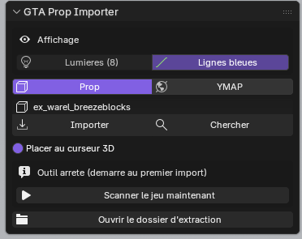

# GTA Prop Importer

Addon Blender (extension 4.2+) pour [Sollumz](https://github.com/Sollumz/Sollumz) : tape le nom d'un prop ou d'un ymap GTA V, il arrive dans Blender avec ses textures.

*Blender extension for [Sollumz](https://github.com/Sollumz/Sollumz): type a GTA V prop or ymap name and it lands in Blender with its textures. — [English below](#english)*

## Français

### Fonctions
- **Prop** : importe un prop par son nom (ex. `prop_bench_01a`), modèle + textures.
- **YMAP** : importe un ymap complet (ex. `dt1_02_strm_0`), option *modèles HD seulement* et filtre des props à ignorer (jokers `*` et `?`).
- **Chercher** : recherche de props ou de ymaps par nom.
- **Placer au curseur 3D**, afficher/masquer les **lumières** et les **lignes bleues** (hiérarchie parent/LOD).
- **Ouvrir le dossier d'extraction** pour retrouver les fichiers extraits.

### Prérequis
- Windows, Blender 4.2 ou plus récent, **Sollumz** activé.
- **GTA V** installé (Legacy ou Enhanced, Rockstar / Steam / Epic).
- **CodeWalker** (pour `CodeWalker.Core.dll`).
- .NET Framework 4.8 (`csc.exe` de Windows) : l'outil `PropGrabber.cs` est compilé automatiquement au premier import.

### Installation
1. Télécharge `gta_prop_importer.zip` dans la page **Releases**.
2. Blender → *Edit > Preferences > Get Extensions* → menu ⌄ → *Install from Disk* → choisis le zip.
3. Dans les préférences de l'addon, indique le **dossier CodeWalker** et le **dossier GTA V** (bouton *Détecter GTA V*).

### Utilisation
Vue 3D → touche **N** → onglet **Sollumz Tools** → **GTA Prop Importer**. Choisis *Prop* ou *YMAP*, tape le nom, clique sur **Importer**.

## English

### Features
- **Prop**: import a prop by name (e.g. `prop_bench_01a`), model + textures.
- **YMAP**: import a whole ymap (e.g. `dt1_02_strm_0`), with *HD models only* and a skip filter (`*` and `?` wildcards).
- **Search** props or ymaps by name.
- **Place at 3D cursor**, toggle **lights** and the **blue lines** (parent/LOD hierarchy).
- **Open the extraction folder**.

### Requirements
Windows, Blender 4.2+, Sollumz, GTA V installed, CodeWalker (`CodeWalker.Core.dll`), .NET Framework 4.8 (`PropGrabber.cs` is compiled automatically on first import).

### Install
Download `gta_prop_importer.zip` from **Releases** → Blender *Preferences > Get Extensions > Install from Disk*. Set the CodeWalker and GTA V folders in the add-on preferences.

### Usage
3D View → **N** → **Sollumz Tools** tab → **GTA Prop Importer**.

## Licence
GPL-3.0-or-later — voir [LICENSE](LICENSE).
